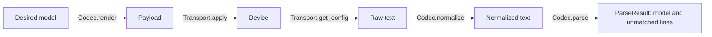

# Drivers (NEDs)

A NED (Network Element Driver) is a Python package that knows one kind of device: how to reach it, how its configuration reads, and how to turn that text into ACE-X's vendor-neutral model and back. Most of ACE-X works on the model and never sees a device's syntax.

## Built-in drivers

| Driver | Package | OS |
|--------|---------|-----|
| Cisco IOS CLI | `acex-driver-cisco-ioscli` | Cisco IOS XE |
| Cisco IOS (classic) CLI | `acex-driver-cisco-ios-classic-cli` | Cisco IOS |
| Juniper JunOS CLI | `acex-driver-juniper-junoscli` | Juniper JunOS |

## The pieces

A driver is a few small classes tied together by one more. Their base classes are in `devkit/src/acex_devkit/drivers/base.py`.

| Class | What it does | Talks to the device? |
|---|---|---|
| `NetworkElementDriver` | Names the pieces below and the platforms the driver supports. No logic of its own. | No |
| `Transport` | Opens the session, sends commands and returns text: `open`, `close`, `get_config`, `apply`, `execute`. One instance per session, and the only part that holds device state. | Yes |
| `Codec` | Turns configuration text into the model (`parse`) and the model into text (`render`, `render_patch`). Also `normalize` and `mask`. Pure: no device, no network. | No |
| `State` | Reads operational facts into devkit models, for example `get_facts` (model, serial number, version) and `get_arp_table`. | Through the transport it is given |
| `Actions` | Runs actions on the device, for example `ping`. | Through the transport it is given |

A driver implements only the optional methods it can. Which ones it has is read off the class, so a driver never declares its capabilities by hand. Callers do not use the pieces directly; they open a `Session` (`driver.session(node, credentials)`), which runs one call at a time.



## Parse: what goes in and what comes out

`Codec.parse(raw, node)` takes the configuration text of a device and returns a `ParseResult` with two parts:

- `configuration` is the model, a `ComposedConfiguration`: hostname under `system`, interfaces under `interfaces`, and so on, the same for every vendor.
- `metadata` is information about the parsing. It holds `spans`, which lines made which component, and `unmatched`, a list of the lines the driver could not translate.

In the Cisco IOS driver `parse` is one line: it normalizes the text and hands it to the mapper (see below). Take this configuration:

```
interface GigabitEthernet1/0/1
 description Uplink
 no shutdown
 mls qos trust dscp
```

If the driver has a declaration for `description` and `no shutdown` but none for `mls qos trust`, the first two end up in the model and the third is kept as an unmatched line:

```
UnmatchedLine(
    line=" mls qos trust dscp",
    parents=["interface GigabitEthernet1/0/1"],
)
```

`line` is the line as the device wrote it, and `parents` are the header lines it sat under, outermost first.

An unmatched line is kept, not dropped, for two reasons. The comparison of desired and observed state would otherwise look clean while the device has settings ACE-X does not know about, so the lines travel with the node's diff and their number is part of the compliance result. And the list is a to-do list for the driver author: the most common unmatched lines are the ones to teach the driver next.

## Three forms of a configuration

A configuration exists in three forms:

- Raw: exactly what the device printed, with nothing removed. `Transport.get_config` returns it.
- Normalized: raw without the lines that change by themselves, for example the timestamp of the last change, so that two reads of the same device compare equal. `Codec.normalize` does this, and the Cisco driver parses this form.
- Parsed: the model plus the unmatched lines.

Secrets are replaced by `Codec.mask`, which returns a new text and gives the same result when it is applied twice. The rules are `RewriteRule`s in the driver's normalizer, and each one swaps a secret for `<REDACTED>`. When an agent uploads a configuration, the backend runs `normalize` and then `mask` on it and stores only the result (`DeviceConfigManager.upload_config`). The worker masks patches and command output the same way before it shows them.

## Declaring the syntax

A driver does not need a hand-written parser. It declares the syntax once, with `Block`, `Line`, `Flag` and `Dispatch` from `acex_devkit.drivers.mapper`, and a `Mapper` reads text into the model and writes the model back to text from the same declarations, so the two directions cannot drift apart. The declarations usually live in a `syntax.py`; read the docstring of `Block` in `devkit/src/acex_devkit/drivers/mapper/syntax.py` first.

Which lines to drop and which to mask are separate rules, written as `LineRule`, `BlockRule` and `RewriteRule` on a `BaseNormalizer` subclass (`acex_devkit.normalizer`).

## How a driver is found and delivered

A driver registers itself with the `acex.neds` entry point in its `pyproject.toml`:

```toml
# In a driver's pyproject.toml
[project.entry-points."acex.neds"]
cisco-ios-cli = "acex_driver_cisco_ioscli:CiscoIOSCLIDriver"
```

- The driver's name is its class name. It is stored as `ned_id` on an asset, and the backend's `NEDManager` finds the driver by that name.
- A driver declares the platforms it supports with `platforms = [Platform(vendor=..., os=...)]`, and `driver.supports(asset)` checks an asset against them. `Vendor` and `OS` come from the devkit (`acex_devkit.models.platform`), so a new vendor or OS has to be added there first, together with a version scheme (`acex_devkit.os_versions`).
- The backend lists the installed drivers at `GET /api/v1/neds`, packages each one as a wheel and serves it at `/api/v1/neds/download/{filename}`. Agents and workers fetch the drivers they are missing, or have at another version, and install them with pip.

## Errors

A transport should raise the devkit's exceptions, not the library's, so that callers handle one set whatever library the driver uses: `AuthenticationFailed`, `ConnectionTimeout` and `ConnectionError` for the connection, `ConfigurationError` for a rejected change, and `DriverException` as the base of them all (`acex_devkit.exceptions`).

## Writing a new driver

1. Read `devkit/src/acex_devkit/drivers/example_ned.py`, a small NED that runs against a fake device, and then the Cisco IOS driver in `drivers/cisco_ios_cli/`: `transport/transport.py`, `normalizer.py`, `syntax.py`, `state.py` and `codec.py`.
2. Make a package with the same layout and register it with the `acex.neds` entry point.
3. Write the transport, then the normalizer rules, then the syntax declarations. Test the codec with text files and the transport against something that speaks the protocol (the repository's `mock-device/` is one), so that no test needs a real device.
4. Declare the platform, and add the vendor, OS and version scheme to the devkit if they are new.
5. Add the package to the CI matrices, the README and the cross-package integration test, the way the existing drivers are.
