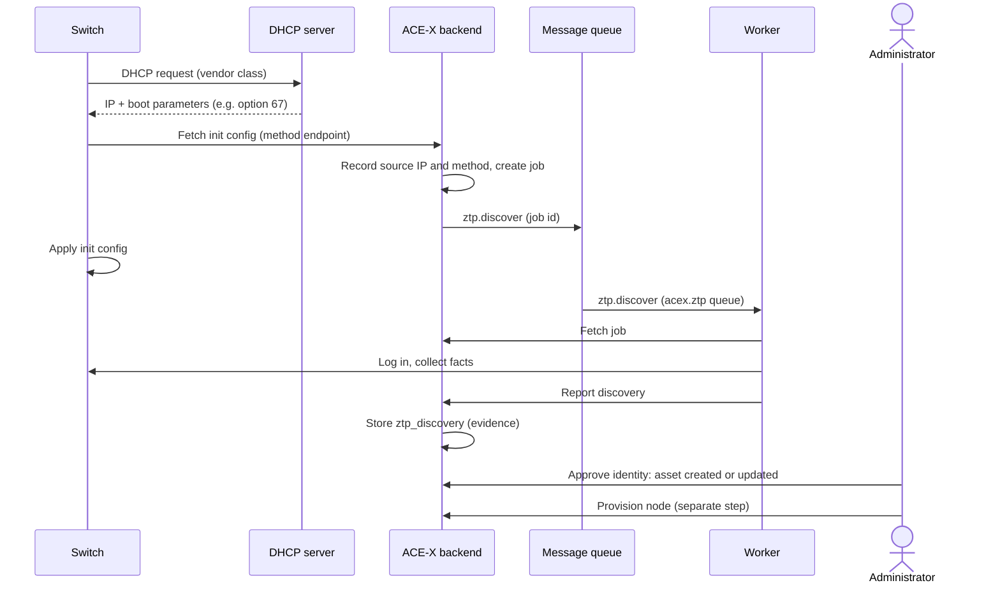

# Zero touch provisioning

Zero touch provisioning (ZTP) takes a switch from factory default to a device that is registered in ACE-X and reachable for further configuration, without anyone touching it.

Nothing the switch reports is trusted on its own. Fetching the init config is unauthenticated, and the serial number comes from the device itself, so discovery only records a claim: "the device at IP Y says it is serial X". An administrator always reviews that claim and approves it before ACE-X pushes any full configuration.

## Workflow

### ZTP methods

How a device is brought up differs per platform: what DHCP hands out, what the device fetches, what the init config contains and how the worker collects facts. Each combination is a named ZTP method. The method is determined by which init endpoint the device fetches, and the DHCP server picks that endpoint from the device's vendor class.

The method is stored on the job and on the `ztp_discovery` row. It tells the worker which platform to expect and how discovery is done.

| Method | Platform | Init | Discovery |
|---|---|---|---|
| `cisco-iosxe-python` | Cisco IOS-XE (e.g. Catalyst 9300) | DHCP option 67 points to a `ztp.py` script that the switch downloads over HTTP and runs | SSH with the temporary credentials from the init config |

### 1. Init

The switch boots with no configuration and requests an IP address over DHCP. The lease includes boot parameters that depend on the vendor class and point the device to the init endpoint for its ZTP method.

The init config is the smallest possible configuration that makes the switch reachable from ACE-X. With `cisco-iosxe-python` it generates a certificate for SSH and configures a temporary username and password.

The init config must be fetched over HTTP. A transfer the backend does not see itself, such as TFTP from a separate server, gives no source IP to register.

### 2. Registration

When the init config is fetched, the backend records which IP fetched it — from `X-Forwarded-For` if the request came through a trusted proxy, otherwise from the packet's source address. The IP and the ZTP method are stored with a new job, and a `ztp.discover` message is published on the message queue.

At this point the backend only knows an IP address and a method. It does not know which device, asset or node it is talking to.

### 3. Discovery

A worker consumes the message from the `acex.ztp` queue. It reads the job id from the message and fetches the job from the ACE-X API, which tells it that this is a `ztp.discover` job, which IP to target and which ZTP method was used.

The method decides how the worker collects facts. With `cisco-iosxe-python` it logs in over SSH and collects the serial number, hardware model, OS and OS version.

The message is published when the init config is fetched, before the device has applied it, so the worker retries with backoff until the device answers or a timeout is reached.

It reports the facts back to the backend, which stores them as a row in `ztp_discovery`. Discovery does not create or change assets or nodes; the row is evidence waiting for review. If the worker cannot log in or collect facts before the timeout, the job fails and no row is written.

### 4. Approval

An administrator reviews each discovery and decides whether to trust the device's identity. The worker logged in at the source IP, so the reported serial number and facts come from the device at that address; the administrator judges whether that IP is where the expected device should be.

Approval is about identity only. It never changes a node and never pushes configuration.

- **Approve:** the asset with the reported serial number is created if none exists (vendor, hardware model, OS, OS version, and the NED chosen for the method), or updated with the hardware model, OS and OS version that differ. The discovery records the asset it was approved as, and other unreviewed discoveries of the same serial are rejected.
- **Reject:** the discovery is marked rejected. Nothing else changes.

What approval would do is shown before it happens. Every unreviewed discovery carries a `proposal`, computed by the same code that approves it:

| `action` | Meaning |
|---|---|
| `create` | No asset has the serial; `asset` is what will be created |
| `update` | The asset exists; `changes` lists each field's current and reported value |
| `unchanged` | The asset already matches |
| `blocked` | It cannot be approved; `blocked_by` says why: an unknown vendor or OS, a missing fact, an OS version its scheme rejects, a vendor that differs from the asset's, or several assets with the serial |

The proposal has a `hash`. Approve sends it back, and is refused if the proposal has changed since it was shown.

Conflicts are shown alongside: the same serial reported from another IP, the same IP previously reporting another serial (both identity conflicts), and a serial that belongs to a provisioned node, which may have been reset.

### 5. Bulk approval

Many devices can be discovered and approved without being bound to a node. A bulk approval first runs as a dry run, which goes through exactly the same steps and rolls back, and answers per discovery with its proposal or the reason it would be skipped. Discoveries with a blocked proposal, an identity conflict or a changed proposal are skipped; one with an identity conflict can still be approved on its own.

### 6. Provisioning

To be defined. Full configuration is compiled, pushed over SSH and verified; the node ends in `provisioned` or `failed`.

## Node provision status

`provision_status` on the node says whether it is in ZTP and, once provisioning starts, how far it has come. Steps that happen before ACE-X knows which node a device belongs to (init and discovery) are tracked on the job and the discovery, not on the node.

| Status | Kind | Meaning |
|---|---|---|
| `unprovisioned` | steady | Bound to an asset, not in ZTP |
| `adopted` | steady | Brownfield: already running when brought under management |
| `enrolled` | in ZTP | Waiting for its device to be discovered, approved and provisioned |
| `provisioning` | in ZTP | Full config being pushed and verified |
| `provisioned` | steady | Provisioned by ACE-X and verified |
| `failed` | in ZTP | Until retried or cancelled; the reason is on the job |

Claiming an asset enrolls its node. A node can also be enrolled on its own, from `unprovisioned`, `adopted` or `provisioned` (to provision it again from scratch). The status it had is kept in `ztp_previous_status`.

ZTP can always be cancelled. The node returns to `ztp_previous_status`, and any queued provisioning job is cancelled. If a provisioning job was running, the job is cancelled and the node is left `failed` instead, since a worker may have started configuring the device; cancelling again takes it out. A worker still running a cancelled job gets 409 when it reports, so it cannot move the node afterwards, though it may already have pushed configuration.

A provisioning node is **stalled** when nothing is moving it forward: it has no provisioning job, its latest job is not queued or running, its job has been queued longer than `ACEX_ZTP_PROVISION_QUEUE_TIMEOUT_MINUTES` (default 10), or running longer than `ACEX_ZTP_PROVISION_RUN_TIMEOUT_MINUTES` (default 30). It can be stepped back to `enrolled` (usually ready again) or cancelled.

## The `ztp_discovery` table

One row per discovery the worker reports.

| Column | Description |
|---|---|
| `id` | Primary key |
| `job_id` | The `ztp.discover` job that produced it |
| `source_ip` | IP that fetched the init config |
| `method` | ZTP method used, e.g. `cisco-iosxe-python` |
| `serial_number` | Serial number as reported by the device |
| `vendor`, `hardware_model`, `os`, `os_version` | Facts collected by the worker |
| `asset_id` | The asset it was approved as |
| `review_status` | `unreviewed`, `approved` or `rejected` |
| `reviewed_by`, `reviewed_at` | Who reviewed it and when |
| `created_at` | When the discovery was reported |

The worker reports a discovery by finishing its `acex.ztp.discover` job with a result (`serial_number`, `vendor`, `hardware_model`, `os`, `os_version`). The row is written, and the node matched, in the same transaction that marks the job succeeded.

## Call-ins API

Every init config fetch starts a `ztp.discover` job. `/api/v1/ztp_calls` shows them one device per source IP, newest first, with the latest job deciding the stage: `waiting` (no worker has picked it up), `discovering`, `failed` or `reported` (a `ztp_discovery` row awaits review). A device that reboots and calls in again adds an attempt to the same IP.

Call-ins are not tied to a site. The Discovery page can group them by subnet, with a prefix length the operator picks. A stronger IP-to-site link is left for when ACE-X has an internal IPAM.

| Method | Path | Description |
|---|---|---|
| `GET` | `/ztp_calls` | Call-ins per IP. Filter: `stage` |
| `POST` | `/ztp_calls/{ip}/retry` | Queue discovery of that IP again; 503 without a broker |

## Review API

Reviews live under `/api/v1/ztp_discoveries`, which requires a token. They are deliberately not under `/api/v1/ztp`: everything there is public so that a factory-default device can fetch its init config.

| Method | Path | Description |
|---|---|---|
| `GET` | `/ztp_discoveries` | List discoveries, newest first, with `conflicts` and (unreviewed) `proposal`. Filters: `review_status`, `asset_id`, `serial_number`, `source_ip` |
| `GET` | `/ztp_discoveries/{id}` | One discovery |
| `POST` | `/ztp_discoveries/{id}/approve` | Approve as proposed. Body `{"proposal_hash": ...}`, optional; 409 if it no longer matches or the proposal is blocked |
| `POST` | `/ztp_discoveries/{id}/reject` | Reject |
| `POST` | `/ztp_discoveries/approve` | Bulk: `{"items": [{"discovery_id", "proposal_hash"}], "dry_run": bool}`; per-item `outcome` and a `summary` |
| `POST` | `/ztp_discoveries/reject` | Bulk: `{"discovery_ids": [...]}` |

Reviewing a discovery that is already reviewed answers 409.

## Pipeline API

Where each node stands in ZTP, and taking it in or out. An enrolled node's stage comes from its asset: `awaiting_device` (no discovery of the serial, or only rejected ones), `awaiting_approval` (the latest discovery is unreviewed) or `ready` (the latest is approved). Otherwise the stage is the node's `provision_status`.

| Method | Path | Description |
|---|---|---|
| `GET` | `/ztp_nodes` | Nodes in ZTP, stalled and failed first. Filters: `stage` (any stage), `stalled` |
| `GET` | `/ztp_nodes/summary` | Every node counted once per stage, how many are `stalled`, and `pool`: approved assets bound to no node |
| `GET` | `/ztp_nodes/{node_id}` | One node with its asset, readiness, the approved IP, the discoveries of its serial and its `acex.ztp.provision` jobs |
| `POST` | `/ztp_nodes/{node_id}/enroll` | Take the node into ZTP; 409 if it is already in ZTP or bound to an asset cluster |
| `POST` | `/ztp_nodes/{node_id}/cancel` | Take the node out of ZTP (see above); 409 if it is not in ZTP |
| `POST` | `/ztp_nodes/{node_id}/reset` | Step a provisioning or failed node back to `enrolled`, cancelling any provisioning job |

## Methods API

The methods are code, but each has a row in `ztp_method` with what an administrator has chosen for it: the NED that discovery uses. The worker looks it up for the job's method; with no NED chosen, the discovery job fails. A NED the worker does not have yet is installed from the backend first. Like reviews, this requires a token and is not under `/api/v1/ztp`.

| Method | Path | Description |
|---|---|---|
| `GET` | `/ztp_methods` | Every method, with its chosen NED |
| `GET` | `/ztp_methods/{method}` | One method |
| `PUT` | `/ztp_methods/{method}` | Choose the NED (`{"ned": "..."}`, or `null` to clear); 422 if the NED is not installed in the backend |

## Open questions

- A discovered serial with no matching claim: should it show up under unclaimed assets from the `ztp_discovery` row, and should claiming it create the asset? Either way the node still goes through `awaiting_approval`.
- How long `unreviewed` discoveries are kept, and whether a newer discovery for the same serial supersedes an older one.
- More methods. Arista EOS ZTP (option 67 URL) and Junos ZTP (option 43, HTTP transfer mode) fit the same flow; the Junos init config must also set root authentication and enable SSH. Cisco PnP is a different protocol: the backend acts as a PnP server, and the device reports its serial number in the protocol itself, so discovery may not need SSH. A PnP serial number is still self-reported and goes through approval like any other.
