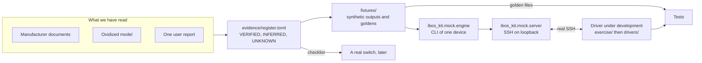
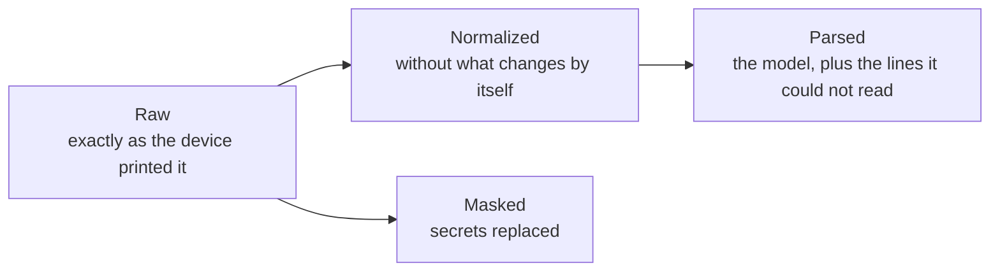

# Architecture

The kit lets a driver for Waystream iBOS be built and tested without a switch. Everything that stands in for the
device is built from what we have actually read, and every answer the stand-in gives says how well it is known.

## The parts

| Part | Where | What it does |
|---|---|---|
| Evidence register | `evidence/register.toml`, `docs/evidence.md` | One entry per thing we believe about iBOS: the statement, how we know it, and how to find out when we do not. The matrix in `docs/evidence.md` is generated from it. |
| Fixtures | `fixtures/` | Made-up outputs in the layout the sources show, and the expected results (golden files) of normalizing, masking and parsing them. `manifest.toml` says what each file stands for. |
| Mock engine | `src/ibos_kit/mock/engine.py` | The command line of one device: prompts, user and admin mode, `enable`, privilege levels, `show` commands, the error layout. No network. |
| Scenarios | `src/ibos_kit/mock/scenarios.py` | Profiles A to F: which device, which firmware, which commands exist, where it lands after login, which faults are on. |
| Mock server | `src/ibos_kit/mock/server.py` | Puts the engine behind SSH. Loopback only, synthetic credentials, a throwaway host key, no shell on the host. |
| Masking | `src/ibos_kit/masking.py` | The secret rules as a component of their own, with a report that names rules and never values. |
| Accounting | `src/ibos_kit/accounting.py` | Tells a test which lines a parser has to report as unmatched, so nothing can disappear silently. |
| Exercise driver | `exercise/` | The skeleton of the driver with stubs, and the tests that say when each exercise is done. |

## Three forms of a configuration

A driver keeps three forms apart, and each has its own test.

- Raw is what the transport returns: no prompt, no echo, nothing else removed. A `!volatile` line is still in it. It is
  what gets stored as the observed state, so that nothing is lost.
- Normalized is raw without lines that differ for reasons that are not intent: `!volatile` lines, the version comment,
  the end marker, lone `!` separators. Two reads of the same switch, with and without a DHCP client connected, normalize
  to the same text. Only this form is compared and parsed.
- Parsed is the model (`ComposedConfiguration`) and the list of lines the driver did not understand. Unknown syntax is
  kept, with the header lines it sat under. A driver that drops what it does not know would make a diff look clean while
  the device is not.
- Masked is a copy for storing and showing. Masking works on raw or normalized text, never changes the number of lines,
  and masking twice gives the same result.

## What the mock does and does not claim

The mock answers a command whether or not we know the real answer. `python -m ibos_kit.mock b --explain` lists, for a
scenario, which behaviours are verified, which are inferred and which are plain assumptions. While the mock runs it logs
each command with the level of the evidence behind its answer. A test that passes against an assumed behaviour proves
that the driver agrees with our assumption and nothing about the switch.

Three kinds of behaviour are therefore kept apart:

1. Verified in a document: the prompts and the user and admin modes, which commands need admin level, the layout of
   `show version` on 6.3.0, `!volatile` lines, interface names, that a port without `no shutdown` is disabled.
2. Inferred: the layout of `show version` on 6.3.5 and 7.x, where the hostname line sits on an MS4000, SSH on a 6.3.0
   switch (the manual dates `sshd` to 6.3.4).
3. Assumed, no source at all: how `enable` fails, whether the prompt ends in a space, the error answers beyond one user
   report, what the SSH server offers.

Configuration mode is documented in the MS 7000 command reference (prompts, `end`, `exit`, `do`, `write memory`) but has
never been tried on a device and its error answers are not documented. It therefore exists only behind
`--experimental-config-mode`, announces itself in the greeting and in the log, and its tests are marked `experimental`.

## Boundaries

- The mock listens on `127.0.0.1` or `::1` only; any other address is refused in code, not by convention.
- It never runs a host command, never reads `~/.ssh`, never writes a key to disk, and uses made-up credentials that are
  printed in the README.
- The kit does not change the devkit. The Waystream vendor, OS and version scheme were added to it separately (acex pull
  request 386) and reach the published devkit with its next release; device types wait for the customer's models. The
  exercise driver declares no platform yet.
- The kit is not in the CI of the repository. Its tests run with `pytest` from `waystream-kit/`.
